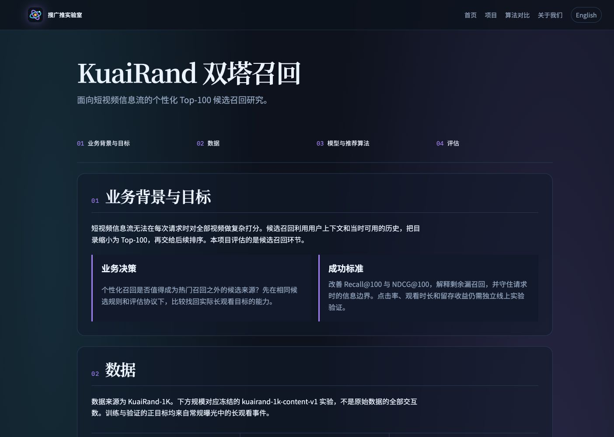
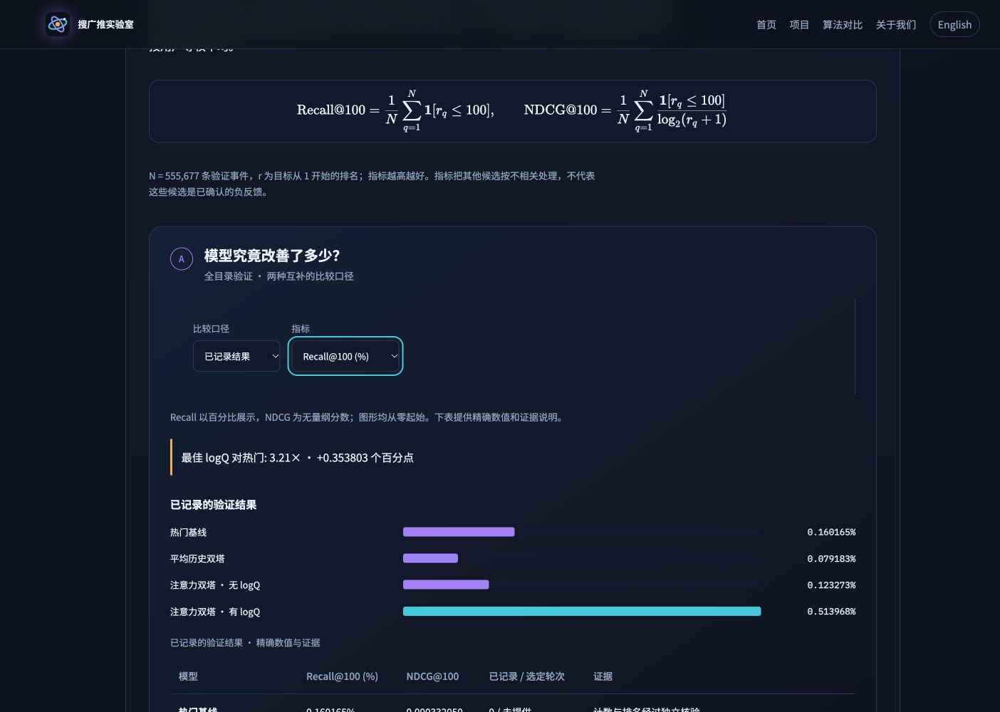
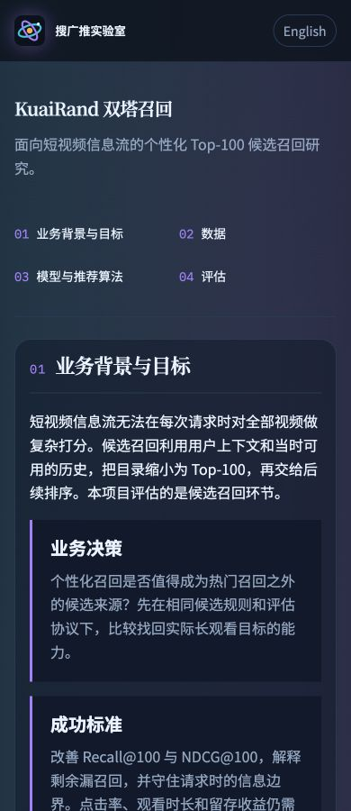
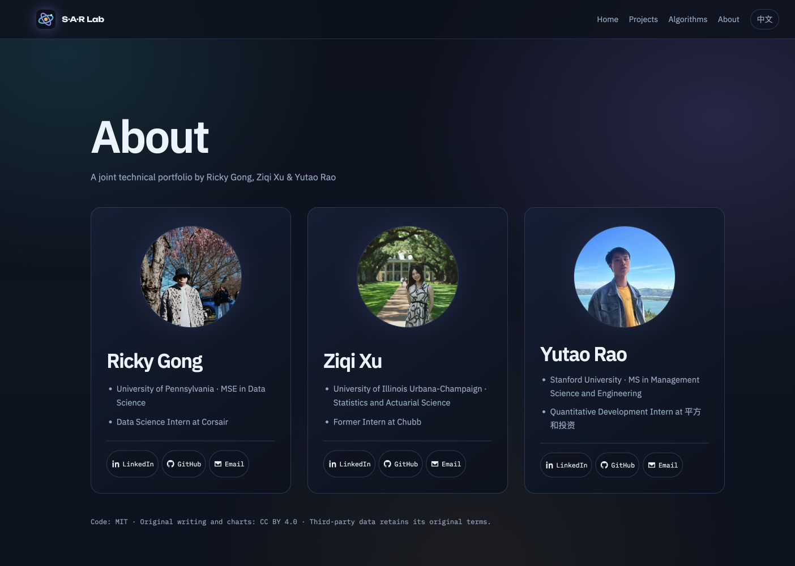

# KuaiRand case-study validation

Validated on 2026-10-18 against the production Astro build, based on main `5e33772` and the 2026-10-17 KuaiRand-1K report. The report's embedded JSON is the source for the generated page artifact; no training or sealed-test evaluation was performed.

## Content and routes

- Both locales contain exactly four primary blocks: business background and goals, data, model and recommendation algorithm, evaluation.
- The introduction contains only a one-line project title and a one-sentence description, followed by section navigation. Counts belong to Data; measured results, research status and evidence links belong to Evaluation.
- Four project cards appear in the same order on both home and project-list pages: Spotify, MovieLens, Goodreads Poetry, KuaiRand. KuaiRand is in progress and links to its case study.
- A read-only check of all 23 generated HTML pages confirmed that internal page/asset links resolve, no internal Roadmap links remain, neither Roadmap route is generated, and both KuaiRand pages expose the four expected section IDs and artifact-backed metrics.
- Pure results remain a separate historical milestone. The 1K source is identified as the independent frozen Drive release; no ANN serving or online improvement is claimed.

## Automated checks

All passed:

```sh
npm run build
npm test
node scripts/build-kuairand-artifacts.mjs --check
uv run --locked pytest
uv run --locked --directory research/kuairand/training pytest tests -q
uv run --locked --directory research/kuairand/training ruff check . ../evaluation --exclude vendor --config pyproject.toml
git diff --check
```

- Astro: 0 errors, warnings or hints; 23 static pages.
- JavaScript: 25 tests, including artifact/source equality, checkpoint selection, epoch protocol consistency, coverage count conservation, missing-value handling and metric formatting.
- Root Python: 92 tests. Independent training environment: 24 CPU tests. Ruff passed.

## Browser checks

Production preview used the configured `/search-rec-ads-portfolio/` base path. The following were checked with actual DOM geometry in both English and Chinese:

| Viewport width | KuaiRand title | Page overflow | Each member's three contact links |
| ---: | --- | --- | --- |
| 360 | One complete line | None | Same row; no clipping |
| 390 | One complete line | None | Same row; no clipping |
| 768 | One complete line | None | Same row; no clipping |
| 1024 | One complete line | None | Same row; no clipping |
| 1440 | One complete line | None | Same row; no clipping |

- Native, labelled comparison/metric selects expose visible focus and show the correct current state. Switching to matched epoch 7 and NDCG displays 4.44×, 0.000260317 and 0.001154930. Switching back to Recall displays 3.91× for matched epoch 7 and 3.21× for the best-checkpoint comparison with popularity.
- The summary updates in an `aria-live` region; tables retain both metrics and evidence labels. Controls are hidden until initialized; both comparison tables are present in static HTML.
- Long formulas, tables and the training curve scroll inside their own containers on phones. The curve retains a readable minimum width, and the exact 17-epoch table is available in a disclosure.
- No console warnings or errors were observed on the checked case-study pages. Native selects and disclosures use platform keyboard/touch behavior; browser automation verified selection changes through the select API, not a full assistive-technology audit.
- The page adds no animations; the existing site reduced-motion rule covers anchor scrolling.

## Production screenshots

### Four clearly separated sections



### Model comparison with exact values and evidence



### Phone introduction and first section



### English About contact buttons



## Evidence limits

The mean-history baseline has only a historical aggregate. The without-logQ run is a verified epoch-7 snapshot. Current logQ results are published Colab aggregates; this change does not independently recompute checkpoint ranks. The sealed test and online outcomes remain unmeasured. Publishing the PR does not deploy it: the existing main-branch workflow deploys after merge.
